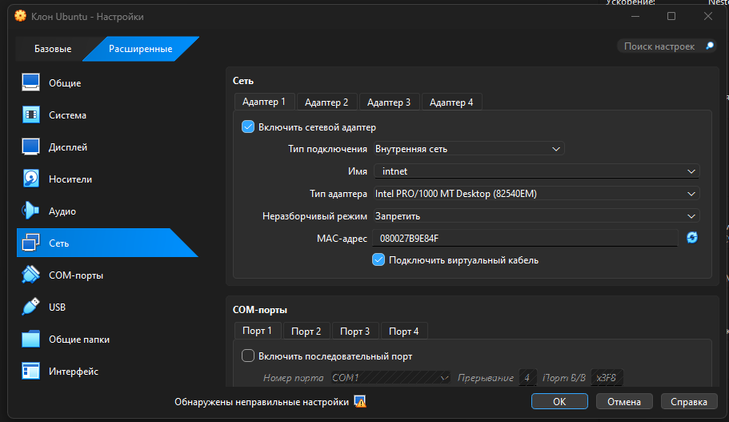

# Report on lab6

## Завдання на лабораторну роботу.

# 1. Підготовка к роботі

Спочатку перевірив правила мережі:

для першого убунту:


Тут скріншот де вказан NAT, та проброс портів з минулої лаби

Також був добавлен 2 адаптер з настройкою внутрішньої мережі:


Для клона убунту я змінив тільки мережу на внутрішню:



# 2. Налаштування першого убунту:

Спочатку я зайшов в акаунт через мобу як в минулій лабі.


Потім прочитав вміст файлу interfaces

```
student@CsnKhai:~$ cd /
student@CsnKhai:/$ cat etc/network
cat: etc/network: Is a directory
student@CsnKhai:/$ cat etc/network/interfaces
# This file describes the network interfaces available on your system
# and how to activate them. For more information, see interfaces(5).

# The loopback network interface
auto lo
iface lo inet loopback

# The primary network interface
auto eth0
iface eth0 inet dhcp
student@CsnKhai:/$
```

Після цього я відредагував цей файл за допомогою nano:

```
student@CsnKhai:/$ sudo nano etc/network/interfaces
[sudo] password for student:
student@CsnKhai:/$
```

```
# This file describes the network interfaces available on your system
# and how to activate them. For more information, see interfaces(5).

# The loopback network interface
auto lo
iface lo inet loopback

# The primary network interface
auto eth0
iface eth0 inet dhcp

# The second network interface

auto eth1
iface eth1 inet static
address 10.10.10.1
netmask 255.255.255.0
broadcast 10.10.10.255
```

Після цього підняв новий eth1:

```
student@CsnKhai:/$ ifconfig
eth0      Link encap:Ethernet  HWaddr 08:00:27:c7:5d:ad
          inet addr:10.0.2.15  Bcast:10.0.2.255  Mask:255.255.255.0
          inet6 addr: fd17:625c:f037:2:5830:3677:a34a:1a8b/64 Scope:Global
          inet6 addr: fd17:625c:f037:2:a00:27ff:fec7:5dad/64 Scope:Global
          inet6 addr: fe80::a00:27ff:fec7:5dad/64 Scope:Link
          UP BROADCAST RUNNING MULTICAST  MTU:1500  Metric:1
          RX packets:6608 errors:0 dropped:0 overruns:0 frame:0
          TX packets:6078 errors:0 dropped:0 overruns:0 carrier:0
          collisions:0 txqueuelen:1000
          RX bytes:466895 (466.8 KB)  TX bytes:2571554 (2.5 MB)

lo        Link encap:Local Loopback
          inet addr:127.0.0.1  Mask:255.0.0.0
          inet6 addr: ::1/128 Scope:Host
          UP LOOPBACK RUNNING  MTU:65536  Metric:1
          RX packets:0 errors:0 dropped:0 overruns:0 frame:0
          TX packets:0 errors:0 dropped:0 overruns:0 carrier:0
          collisions:0 txqueuelen:0
          RX bytes:0 (0.0 B)  TX bytes:0 (0.0 B)

student@CsnKhai:/$  sudo ifup eth1
student@CsnKhai:/$ ifconfig
eth0      Link encap:Ethernet  HWaddr 08:00:27:c7:5d:ad
          inet addr:10.0.2.15  Bcast:10.0.2.255  Mask:255.255.255.0
          inet6 addr: fd17:625c:f037:2:5830:3677:a34a:1a8b/64 Scope:Global
          inet6 addr: fd17:625c:f037:2:a00:27ff:fec7:5dad/64 Scope:Global
          inet6 addr: fe80::a00:27ff:fec7:5dad/64 Scope:Link
          UP BROADCAST RUNNING MULTICAST  MTU:1500  Metric:1
          RX packets:6979 errors:0 dropped:0 overruns:0 frame:0
          TX packets:6410 errors:0 dropped:0 overruns:0 carrier:0
          collisions:0 txqueuelen:1000
          RX bytes:493659 (493.6 KB)  TX bytes:2705494 (2.7 MB)

eth1      Link encap:Ethernet  HWaddr 08:00:27:6d:16:d3
          inet addr:10.10.10.1  Bcast:10.10.10.255  Mask:255.255.255.0
          inet6 addr: fe80::a00:27ff:fe6d:16d3/64 Scope:Link
          UP BROADCAST RUNNING MULTICAST  MTU:1500  Metric:1
          RX packets:0 errors:0 dropped:0 overruns:0 frame:0
          TX packets:7 errors:0 dropped:0 overruns:0 carrier:0
          collisions:0 txqueuelen:1000
          RX bytes:0 (0.0 B)  TX bytes:578 (578.0 B)

lo        Link encap:Local Loopback
          inet addr:127.0.0.1  Mask:255.0.0.0
          inet6 addr: ::1/128 Scope:Host
          UP LOOPBACK RUNNING  MTU:65536  Metric:1
          RX packets:0 errors:0 dropped:0 overruns:0 frame:0
          TX packets:0 errors:0 dropped:0 overruns:0 carrier:0
          collisions:0 txqueuelen:0
          RX bytes:0 (0.0 B)  TX bytes:0 (0.0 B)

student@CsnKhai:/$ 
```

# 3. Налаштування клона убунту

Тепер можна 


```

```

---

### Винсновки:

У ході виконання лабораторної роботи №5 я ознайомився з принципами роботи протоколу OpenSSH та організацією безпечного віддаленого доступу в середовищі Linux. Було практично засвоєно генерацію та використання пар асиметричних криптографічних ключів (RSA, ECDSA, Ed25519) для автентифікації без введення паролів.

Вивчено конфігурування служби SSH на сервері, зокрема зміни стандартного порту для захисту від мережевих сканерів, обмеження кола користувачів та повну заборону входу за звичайними паролями і правами суперкористувача. Окрім цього, налаштовано маршрутизацію та перенаправлення портів (Port Forwarding) через NAT у VirtualBox, а за допомогою аналізатора Wireshark на практиці перевірено й доведено повне шифрування трафіку. Виконання цієї роботи дозволило закріпити навички захисту мережевих служб та безпечного адміністрування. Це було дуже цікаво.
