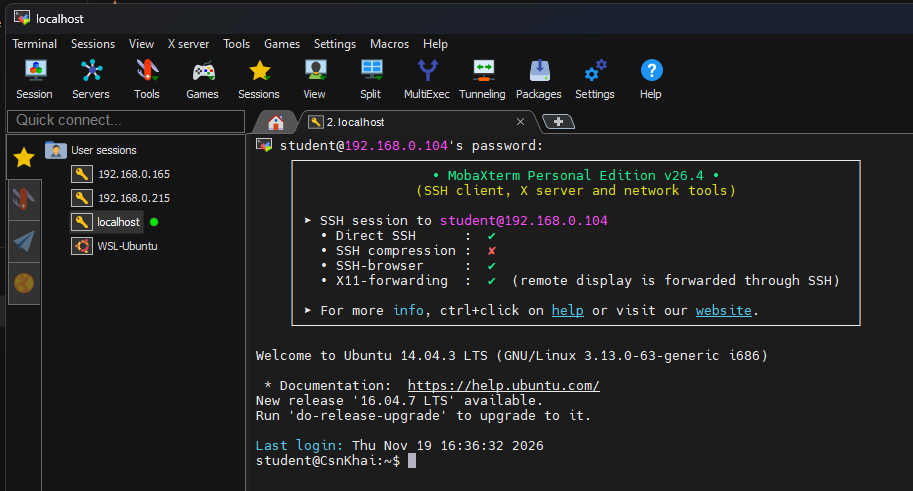
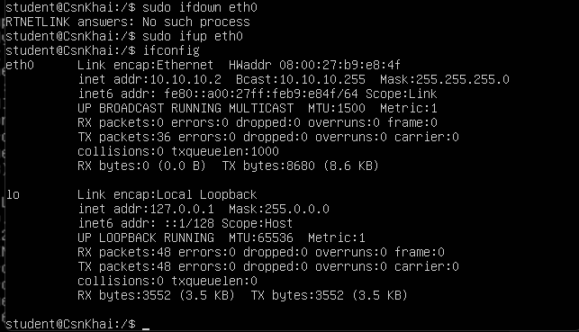
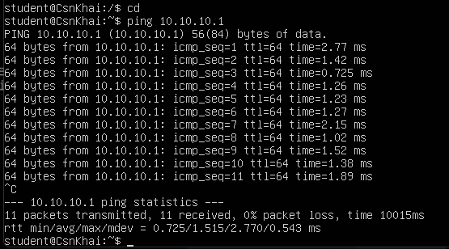
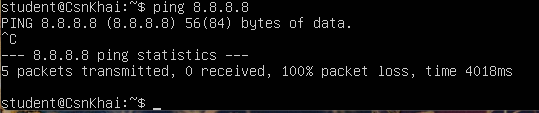
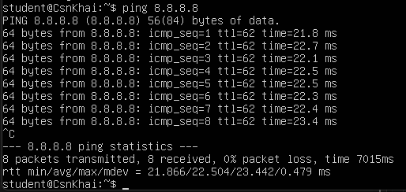
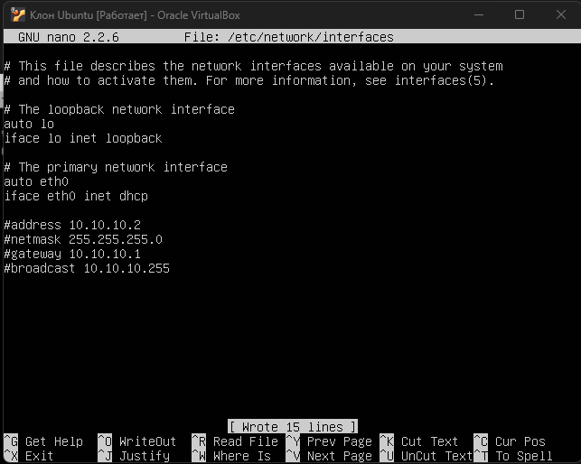
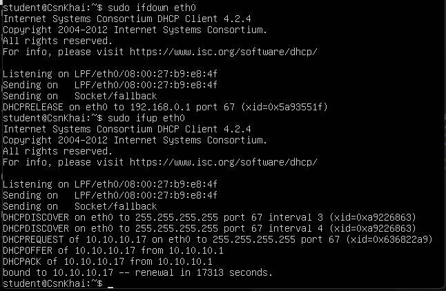
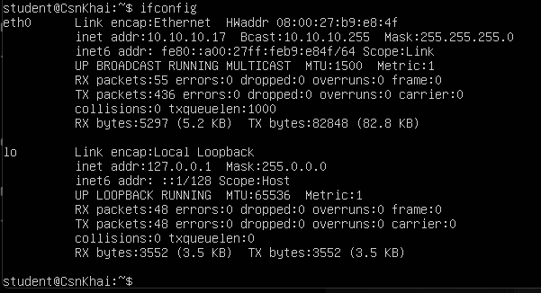

# Report on lab6

## Завдання на лабораторну роботу.

# 1. Налаштування мережевих адаптерів віртуальних машин (створення топології внутрішньої мережі)

Для побудови ізольованої локальної мережі між двома віртуальними машинами та забезпечення доступу до мережі Інтернет через одну з них (шлюз) було виконано конфігурацію мережевих інтерфейсів у VirtualBox.

1. Налаштування першої віртуальної машини (Шлюз):

Для першої машини перший адаптер залишено в режимі NAT із прокиданням портів для підключення через SSH


Також було додано другий мережевий адаптер у режимі Внутрішня мережа (Internal Network) для зв'язку з другою віртуальною машиною


2. Налаштування другої віртуальної машини (Клієнт):

Для клона віртуальної машини мережевий адаптер змінено на режим Внутрішня мережа (Internal Network), що ізолює її від зовнішньої мережі та підключає напряму до першої машини


Отриманий результат: створено мережеву топологію, де перша віртуальна машина має два інтерфейси (зовнішній NAT та внутрішній), а друга — лише один внутрішній інтерфейс

---

# 2. Налаштування першого убунту:

Спочатку я зайшов в акаунт через мобу як в минулій лабі.



Потім прочитав вміст файлу interfaces

```
student@CsnKhai:~$ cd /
student@CsnKhai:/$ cat etc/network
cat: etc/network: Is a directory
student@CsnKhai:/$ cat etc/network/interfaces
# This file describes the network interfaces available on your system
# and how to activate them. For more information, see interfaces(5).

# The loopback network interface
auto lo
iface lo inet loopback

# The primary network interface
auto eth0
iface eth0 inet dhcp
student@CsnKhai:/$
```

Після цього я відредагував цей файл за допомогою nano:

```
student@CsnKhai:/$ sudo nano etc/network/interfaces
[sudo] password for student:
student@CsnKhai:/$
```

```
# This file describes the network interfaces available on your system
# and how to activate them. For more information, see interfaces(5).

# The loopback network interface
auto lo
iface lo inet loopback

# The primary network interface
auto eth0
iface eth0 inet dhcp

# The second network interface

auto eth1
iface eth1 inet static
address 10.10.10.1
netmask 255.255.255.0
broadcast 10.10.10.255
```

Після цього підняв новий eth1:

```
student@CsnKhai:/$ ifconfig
eth0      Link encap:Ethernet  HWaddr 08:00:27:c7:5d:ad
          inet addr:10.0.2.15  Bcast:10.0.2.255  Mask:255.255.255.0
          inet6 addr: fd17:625c:f037:2:5830:3677:a34a:1a8b/64 Scope:Global
          inet6 addr: fd17:625c:f037:2:a00:27ff:fec7:5dad/64 Scope:Global
          inet6 addr: fe80::a00:27ff:fec7:5dad/64 Scope:Link
          UP BROADCAST RUNNING MULTICAST  MTU:1500  Metric:1
          RX packets:6608 errors:0 dropped:0 overruns:0 frame:0
          TX packets:6078 errors:0 dropped:0 overruns:0 carrier:0
          collisions:0 txqueuelen:1000
          RX bytes:466895 (466.8 KB)  TX bytes:2571554 (2.5 MB)

lo        Link encap:Local Loopback
          inet addr:127.0.0.1  Mask:255.0.0.0
          inet6 addr: ::1/128 Scope:Host
          UP LOOPBACK RUNNING  MTU:65536  Metric:1
          RX packets:0 errors:0 dropped:0 overruns:0 frame:0
          TX packets:0 errors:0 dropped:0 overruns:0 carrier:0
          collisions:0 txqueuelen:0
          RX bytes:0 (0.0 B)  TX bytes:0 (0.0 B)

student@CsnKhai:/$  sudo ifup eth1
student@CsnKhai:/$ ifconfig
eth0      Link encap:Ethernet  HWaddr 08:00:27:c7:5d:ad
          inet addr:10.0.2.15  Bcast:10.0.2.255  Mask:255.255.255.0
          inet6 addr: fd17:625c:f037:2:5830:3677:a34a:1a8b/64 Scope:Global
          inet6 addr: fd17:625c:f037:2:a00:27ff:fec7:5dad/64 Scope:Global
          inet6 addr: fe80::a00:27ff:fec7:5dad/64 Scope:Link
          UP BROADCAST RUNNING MULTICAST  MTU:1500  Metric:1
          RX packets:6979 errors:0 dropped:0 overruns:0 frame:0
          TX packets:6410 errors:0 dropped:0 overruns:0 carrier:0
          collisions:0 txqueuelen:1000
          RX bytes:493659 (493.6 KB)  TX bytes:2705494 (2.7 MB)

eth1      Link encap:Ethernet  HWaddr 08:00:27:6d:16:d3
          inet addr:10.10.10.1  Bcast:10.10.10.255  Mask:255.255.255.0
          inet6 addr: fe80::a00:27ff:fe6d:16d3/64 Scope:Link
          UP BROADCAST RUNNING MULTICAST  MTU:1500  Metric:1
          RX packets:0 errors:0 dropped:0 overruns:0 frame:0
          TX packets:7 errors:0 dropped:0 overruns:0 carrier:0
          collisions:0 txqueuelen:1000
          RX bytes:0 (0.0 B)  TX bytes:578 (578.0 B)

lo        Link encap:Local Loopback
          inet addr:127.0.0.1  Mask:255.0.0.0
          inet6 addr: ::1/128 Scope:Host
          UP LOOPBACK RUNNING  MTU:65536  Metric:1
          RX packets:0 errors:0 dropped:0 overruns:0 frame:0
          TX packets:0 errors:0 dropped:0 overruns:0 carrier:0
          collisions:0 txqueuelen:0
          RX bytes:0 (0.0 B)  TX bytes:0 (0.0 B)

student@CsnKhai:/$ 
```

---

# 3. Налаштування 2 убунту (клона першої з минулої лаби)

Тепер настройка 2 убунту, тут вже потрібно було почекати 2 хвилини щоб айпішники підтянулися, і коли вона запустилася, я знову відредагував файл interfaces за допомогою команди:

```
sudo nano etc/network/interfaces
```


Після цього оновив значення eth0:



Після цього перевірив зв'язок між пристроями за допомогою команди пінгу від другої до першої убунту:



А от пінг з другого убунту на зовнішню мережу не получився, через те що обі убунту ізольовані:



---

# 4. 

Повертаємося до першої убунту

Спочатку я розкоментував строку в файлі:

```
student@CsnKhai:/$ sudo nano etc/sysctl.conf
[sudo] password for student:
student@CsnKhai:/$
```

Строка що була розкоментована:

```
# Uncomment the next line to enable packet forwarding for IPv4
net.ipv4.ip_forward=1
```

Після цього я перезапустив убунту та ввів кодманду:

```
student@CsnKhai:~$ sudo iptables -t nat -A POSTROUTING -o eth0 -j MASQUERADE
[sudo] password for student:
student@CsnKhai:~$
```

І після вводу команди пінгу зовнішньої мережі с другої убунту всі пакети дійшли



---

# 5. 

Спочатку я скачав dnsmasq

```
student@CsnKhai:~$ sudo apt update
Get:1 http://security.ubuntu.com trusty-security InRelease [56.5 kB]
Ign http://us.archive.ubuntu.com trusty InRelease
Get:2 http://security.ubuntu.com trusty-security/main Sources [249 kB]
Get:3 http://us.archive.ubuntu.com trusty-updates InRelease [56.5 kB]
Get:4 http://security.ubuntu.com trusty-security/restricted Sources [7,439 B]
Get:5 http://security.ubuntu.com trusty-security/universe Sources [150 kB]
Get:6 http://security.ubuntu.com trusty-security/multiverse Sources [4,294 B]
Get:7 http://security.ubuntu.com trusty-security/main i386 Packages [690 kB]
Get:8 http://us.archive.ubuntu.com trusty-backports InRelease [56.5 kB]
Get:9 http://security.ubuntu.com trusty-security/restricted i386 Packages [19.3 kB]
Get:10 http://security.ubuntu.com trusty-security/universe i386 Packages [386 kB]
Get:11 http://security.ubuntu.com trusty-security/multiverse i386 Packages [6,214 B]
Get:12 http://security.ubuntu.com trusty-security/main Translation-en [225 kB]
Hit http://us.archive.ubuntu.com trusty Release.gpg
Get:13 http://security.ubuntu.com trusty-security/multiverse Translation-en [2,545 B]
Get:14 http://us.archive.ubuntu.com trusty-updates/main Sources [660 kB]
Get:15 http://security.ubuntu.com trusty-security/restricted Translation-en [3,542 B]
Get:16 http://security.ubuntu.com trusty-security/universe Translation-en [156 kB]
Get:17 http://us.archive.ubuntu.com trusty-updates/restricted Sources [9,490 B]
Get:18 http://us.archive.ubuntu.com trusty-updates/universe Sources [351 kB]
Get:19 http://us.archive.ubuntu.com trusty-updates/multiverse Sources [10.2 kB]
Get:20 http://us.archive.ubuntu.com trusty-updates/main i386 Packages [1,163 kB]
Get:21 http://us.archive.ubuntu.com trusty-updates/restricted i386 Packages [22.9 kB]
Get:22 http://us.archive.ubuntu.com trusty-updates/universe i386 Packages [698 kB]
Get:23 http://us.archive.ubuntu.com trusty-updates/multiverse i386 Packages [19.7 kB]
Get:24 http://us.archive.ubuntu.com trusty-updates/main Translation-en [348 kB]
Get:25 http://us.archive.ubuntu.com trusty-updates/multiverse Translation-en [7,583 B]
Get:26 http://us.archive.ubuntu.com trusty-updates/restricted Translation-en [4,014 B]
Get:27 http://us.archive.ubuntu.com trusty-updates/universe Translation-en [275 kB]
Get:28 http://us.archive.ubuntu.com trusty-backports/main Sources [13.8 kB]
Get:29 http://us.archive.ubuntu.com trusty-backports/restricted Sources [28 B]
Get:30 http://us.archive.ubuntu.com trusty-backports/universe Sources [53.4 kB]
Get:31 http://us.archive.ubuntu.com trusty-backports/multiverse Sources [2,560 B]
Get:32 http://us.archive.ubuntu.com trusty-backports/main i386 Packages [17.7 kB]
Get:33 http://us.archive.ubuntu.com trusty-backports/restricted i386 Packages [28 B]
Get:34 http://us.archive.ubuntu.com trusty-backports/universe i386 Packages [59.7 kB]
Get:35 http://us.archive.ubuntu.com trusty-backports/multiverse i386 Packages [1,870 B]
Get:36 http://us.archive.ubuntu.com trusty-backports/main Translation-en [7,503 B]
Get:37 http://us.archive.ubuntu.com trusty-backports/multiverse Translation-en [1,215 B]
Get:38 http://us.archive.ubuntu.com trusty-backports/restricted Translation-en [28 B]
Get:39 http://us.archive.ubuntu.com trusty-backports/universe Translation-en [36.8 kB]
Hit http://us.archive.ubuntu.com trusty Release
Hit http://us.archive.ubuntu.com trusty/main Sources
Hit http://us.archive.ubuntu.com trusty/restricted Sources
Hit http://us.archive.ubuntu.com trusty/universe Sources
Hit http://us.archive.ubuntu.com trusty/multiverse Sources
Hit http://us.archive.ubuntu.com trusty/main i386 Packages
Hit http://us.archive.ubuntu.com trusty/restricted i386 Packages
Hit http://us.archive.ubuntu.com trusty/universe i386 Packages
Hit http://us.archive.ubuntu.com trusty/multiverse i386 Packages
Hit http://us.archive.ubuntu.com trusty/main Translation-en
Hit http://us.archive.ubuntu.com trusty/multiverse Translation-en
Hit http://us.archive.ubuntu.com trusty/restricted Translation-en
Hit http://us.archive.ubuntu.com trusty/universe Translation-en
Ign http://us.archive.ubuntu.com trusty/main Translation-en_US
Ign http://us.archive.ubuntu.com trusty/multiverse Translation-en_US
Ign http://us.archive.ubuntu.com trusty/restricted Translation-en_US
Ign http://us.archive.ubuntu.com trusty/universe Translation-en_US
Fetched 5,831 kB in 11s (521 kB/s)
Reading package lists... Done
student@CsnKhai:~$ sudo apt install dnsmasq
Reading package lists... Done
Building dependency tree
Reading state information... Done
The following packages were automatically installed and are no longer required:
  libpvm3 libreadline-dev libreadline6-dev libtinfo-dev pvm
Use 'apt-get autoremove' to remove them.
The following extra packages will be installed:
  dnsmasq-base libmnl0 libnetfilter-conntrack3
The following NEW packages will be installed:
  dnsmasq dnsmasq-base libmnl0 libnetfilter-conntrack3
0 upgraded, 4 newly installed, 0 to remove and 196 not upgraded.
Need to get 266 kB/325 kB of archives.
After this operation, 970 kB of additional disk space will be used.
Do you want to continue? [Y/n] Y
Get:1 http://us.archive.ubuntu.com/ubuntu/ trusty-updates/main dnsmasq-base i386 2.68-1ubuntu0.2 [251 kB]
Get:2 http://us.archive.ubuntu.com/ubuntu/ trusty-updates/universe dnsmasq all 2.68-1ubuntu0.2 [14.9 kB]
Fetched 266 kB in 0s (268 kB/s)
Selecting previously unselected package libmnl0:i386.
(Reading database ... 54949 files and directories currently installed.)
Preparing to unpack .../libmnl0_1.0.3-3ubuntu1_i386.deb ...
Unpacking libmnl0:i386 (1.0.3-3ubuntu1) ...
Selecting previously unselected package libnetfilter-conntrack3:i386.
Preparing to unpack .../libnetfilter-conntrack3_1.0.4-1_i386.deb ...
Unpacking libnetfilter-conntrack3:i386 (1.0.4-1) ...
Selecting previously unselected package dnsmasq-base.
Preparing to unpack .../dnsmasq-base_2.68-1ubuntu0.2_i386.deb ...
Unpacking dnsmasq-base (2.68-1ubuntu0.2) ...
Selecting previously unselected package dnsmasq.
Preparing to unpack .../dnsmasq_2.68-1ubuntu0.2_all.deb ...
Unpacking dnsmasq (2.68-1ubuntu0.2) ...
Processing triggers for man-db (2.6.7.1-1ubuntu1) ...
Processing triggers for ureadahead (0.100.0-16) ...
ureadahead will be reprofiled on next reboot
Setting up libmnl0:i386 (1.0.3-3ubuntu1) ...
Setting up libnetfilter-conntrack3:i386 (1.0.4-1) ...
Setting up dnsmasq-base (2.68-1ubuntu0.2) ...
Setting up dnsmasq (2.68-1ubuntu0.2) ...
 * Starting DNS forwarder and DHCP server dnsmasq                                                                                    [ OK ]
Processing triggers for libc-bin (2.19-0ubuntu6.6) ...
Processing triggers for ureadahead (0.100.0-16) ...
student@CsnKhai:~$
```

Потім налаштував dnsmasq розкоментувавши строки, та змінивши їх значення в файлі конфіурації:

```
student@CsnKhai:~$ sudo nano /etc/dnsmasq.conf
[sudo] password for student:
student@CsnKhai:~$
```

```
interface=eth1

dhcp-range=10.10.10.10,10.10.10.20,12h
```

---

# 6. 

Спочатку відкрив 2 убунту та відредагував файл налаштування мережі:

```
student@CsnKhai:/$ sudo nano etc/network/interfaces
[sudo] password for student:
student@CsnKhai:/$
```

Закоментував настройки eth0, та змінив статичний айпі на dhcp:



Після цього я перезапустив eth0:



У результаті убунту 2 получила собі свій айпі.

Для перевірки результату я ввів ifconfig:



---

# 7.

Спочатку я ввів команду для виводу вмісту файлу: 

```
student@CsnKhai:~$ sudo cat /etc/resolv.conf
# Dynamic resolv.conf(5) file for glibc resolver(3) generated by resolvconf(8)
#     DO NOT EDIT THIS FILE BY HAND -- YOUR CHANGES WILL BE OVERWRITTEN
nameserver 127.0.0.1
student@CsnKhai:~$
```

Після цього редагую файл налаштування, та розкоментував рядок:

```
student@CsnKhai:~$ sudo nano /etc/dhcp/dhclient.conf
```

```
prepend domain-name-servers 127.0.0.1;
```

Також перевір працездатність команди:

```
student@CsnKhai:~$ dig youtube.com

; <<>> DiG 9.9.5-3ubuntu0.5-Ubuntu <<>> youtube.com
;; global options: +cmd
;; Got answer:
;; ->>HEADER<<- opcode: QUERY, status: NOERROR, id: 45227
;; flags: qr rd ra; QUERY: 1, ANSWER: 4, AUTHORITY: 0, ADDITIONAL: 1

;; OPT PSEUDOSECTION:
; EDNS: version: 0, flags:; udp: 512
;; QUESTION SECTION:
;youtube.com.                   IN      A

;; ANSWER SECTION:
youtube.com.            201     IN      A       142.250.109.136
youtube.com.            201     IN      A       142.250.109.190
youtube.com.            201     IN      A       142.250.109.93
youtube.com.            201     IN      A       142.250.109.91

;; Query time: 28 msec
;; SERVER: 127.0.0.1#53(127.0.0.1)
;; WHEN: Thu Nov 19 18:43:22 UTC 2026
;; MSG SIZE  rcvd: 104

student@CsnKhai:~$
```

---

### Винсновки:

У ході виконання лабораторної роботи №5 я ознайомився з принципами роботи протоколу OpenSSH та організацією безпечного віддаленого доступу в середовищі Linux. Було практично засвоєно генерацію та використання пар асиметричних криптографічних ключів (RSA, ECDSA, Ed25519) для автентифікації без введення паролів.

Вивчено конфігурування служби SSH на сервері, зокрема зміни стандартного порту для захисту від мережевих сканерів, обмеження кола користувачів та повну заборону входу за звичайними паролями і правами суперкористувача. Окрім цього, налаштовано маршрутизацію та перенаправлення портів (Port Forwarding) через NAT у VirtualBox, а за допомогою аналізатора Wireshark на практиці перевірено й доведено повне шифрування трафіку. Виконання цієї роботи дозволило закріпити навички захисту мережевих служб та безпечного адміністрування. Це було дуже цікаво.
