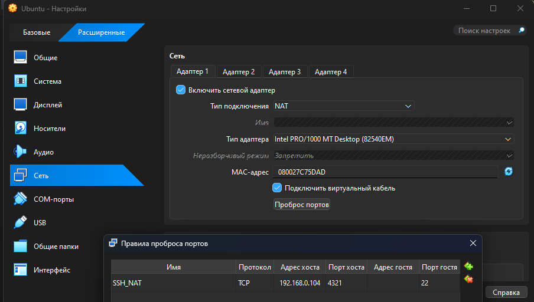
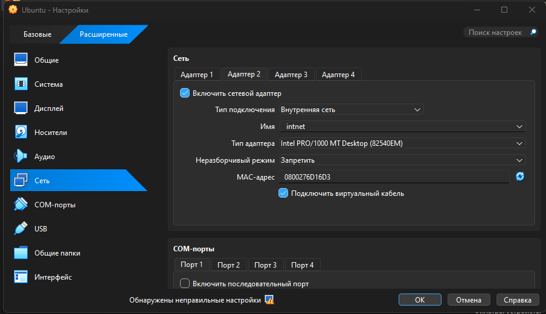

# Report on lab6

## Завдання на лабораторну роботу.

# 1. Підготовка к роботі

Спочатку перевірив правила мережі:

для першого убунту:

Тут скріншот де вказан NAT, та проброс портів з минулої лаби

Також був добавлен 2 адаптер з настройкою внутрішньої мережі:

Для клона убунту я змінив тільки мережу на внутрішню:

# 2. Налаштування першого убунту:

---

### Винсновки:

У ході виконання лабораторної роботи №5 я ознайомився з принципами роботи протоколу OpenSSH та організацією безпечного віддаленого доступу в середовищі Linux. Було практично засвоєно генерацію та використання пар асиметричних криптографічних ключів (RSA, ECDSA, Ed25519) для автентифікації без введення паролів.

Вивчено конфігурування служби SSH на сервері, зокрема зміни стандартного порту для захисту від мережевих сканерів, обмеження кола користувачів та повну заборону входу за звичайними паролями і правами суперкористувача. Окрім цього, налаштовано маршрутизацію та перенаправлення портів (Port Forwarding) через NAT у VirtualBox, а за допомогою аналізатора Wireshark на практиці перевірено й доведено повне шифрування трафіку. Виконання цієї роботи дозволило закріпити навички захисту мережевих служб та безпечного адміністрування. Це було дуже цікаво.
